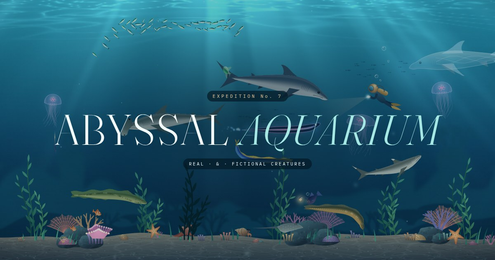

# Abyssal Aquarium

*Expedition No. 7. The previous six are not discussed.*

A quiet discovery game set in a deep-sea tank. Real and fictional creatures
drift in. You watch them, photograph them, and fill in an expedition album
that takes itself very seriously. You are an observer: the creatures get on
with their lives, deal with each other, and now and then something happens
because you were there.

There is no score, no timer and nothing to lose. It is meant to be left open.

**Play it at <https://gseli.github.io/abyssal-aquarium/>**



## Playing

Pick a mode on the start screen:

- **Discovery**: the full game. Species arrive on their own, and some only
  show up under certain conditions. Watch a creature for a couple of seconds
  to log it; photograph it to complete its album entry. Log enough of an
  ecosystem and the way down opens.
- **Aquarium**: a free tank with only the species you have already
  discovered. No challenges; the camera is just for keepsakes.

### Controls

| Action | How |
|---|---|
| Log a species | Keep the pointer on it for about two seconds |
| Read its card | Click it |
| Follow it | Double-click it, or ◉ FOLLOW on its card (Esc to let go) |
| Feed | Click the water |
| Choose bait | Bait dock at the bottom, or keys 1–4 |
| Make a current | Drag quickly through the water |
| Camera | C, then click to take a photo |
| Change ecosystem | Arrows next to the depth gauge |
| Close anything | Esc |

Some things in the scenery respond to a touch, too.

### Ecosystems

Five of them, each one deeper than the last: The Reef, The Fizzing Sea,
The Abyss, The Wreck, and one more that the depth gauge refuses to measure.
Together they hold 44 species. The real ones come with facts you can look
up. The fictional ones come with facts too, but don't look those up.

### Moments

Each ecosystem hides two moments. One happens on its own if you wait; the
other you have to provoke. Photograph one while it is happening and it goes
into the album's **Moments** tab. The tab gives you a hint for each one,
and that is all the help you get.

## Running it locally

No build step and no dependencies. Serve the folder with any static server:

```bash
python3 -m http.server 8000
```

Then open <http://localhost:8000>. Opening `index.html` straight from disk
may not work in some browsers.

Progress is saved in your browser's local storage. **restart expedition** on
the start screen wipes it, but only after you click a second time to confirm.

## Languages

English by default, Spanish on the start screen. The choice is remembered and
survives restarting the expedition.

## Under the hood

- Plain JavaScript and a `<canvas>`, with no framework or bundler.
- The water is drawn with WebGL2, and there is a 2D fallback for browsers
  without it.
- Every creature is drawn in code; there are no image files.
- The sound is generated live with the Web Audio API.
- It respects `prefers-reduced-motion`.
- The only network request is for the fonts, Fraunces and IBM Plex Mono
  from Google Fonts.

The code is commented in Spanish. See [CLAUDE.md](CLAUDE.md) for the
architecture.
